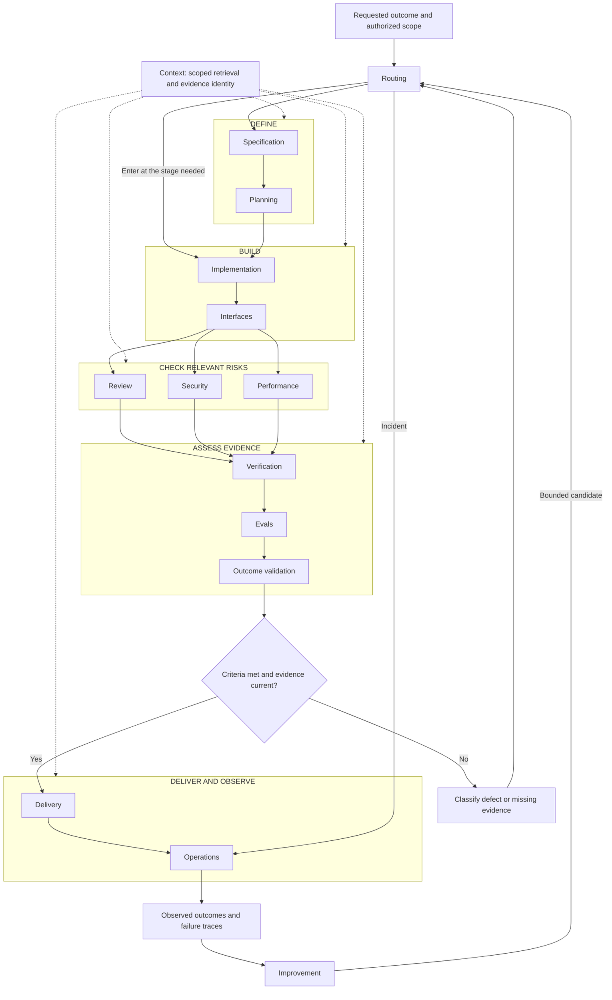
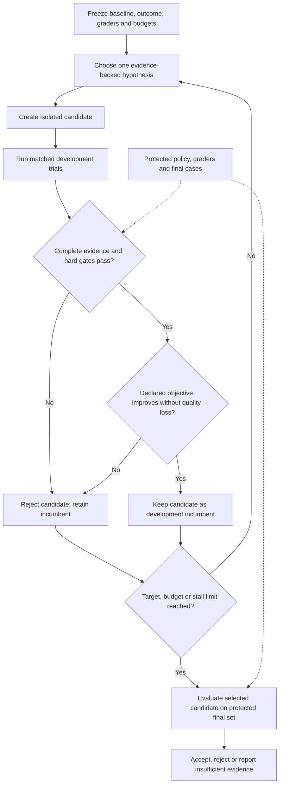

# Agent Skills for Software Factories

[](https://github.com/bijit-ghosh/Agent-Skills/actions/workflows/validate.yml) · [MIT licensed](LICENSE) · **15 focused skills** · **Agent-agnostic workflows**

**Created and maintained by Bijit Ghosh.** Build software factories around explicit behavior, traceable evidence, and measurable outcomes. These 15 skills connect specification, implementation, review, security, performance, evaluation, delivery, operations, and bounded improvement.

The goal is practical: define the behavior you need, build a bounded change, collect evidence, and accept it only when the result meets the original target. A passing test or a higher evaluation score does not establish that the business outcome is correct.

The assurance foundation comes from my article, [Formally Verified, Still Unsafe: Specification Gaps and Residual Risk in Agentic Software](https://medium.com/@bijit211987/formally-verified-still-unsafe-specification-gaps-and-residual-risk-in-agentic-software-998c436ccf6a).

[Skill catalog](#choose-a-skill) · [Install](#installation) · [Agent integration](docs/AGENT-INTEGRATION.md) · [Architecture](#how-it-works) · [Improvement loop](#evaluation-driven-improvement) · [Validation](#what-is-tested) · [Ownership](docs/PROVENANCE.md)

## What you get

- **15 independently installable skills**, covering the lifecycle from intent to observed outcome.
- A [machine-readable catalog](catalog.json), an installer that refuses overwrites, and repository validation utilities.
- A deterministic [development promotion gate](software-factory-improvement/scripts/promotion_gate.py) for screening candidate improvements.
- A [public smoke benchmark](benchmark/README.md), [16 lifecycle review scenarios](evals/README.md), utility tests, and a Windows/Linux CI workflow.
- A detailed [architecture and assurance guide](docs/ARCHITECTURE.md) covering evidence flow, trust boundaries, recovery, and durable state.

These are portable skill folders for compatible AI coding agents. Use them with Cursor, GitHub Copilot, Gemini CLI, OpenCode, Kiro, Claude Code, Codex, or another host that supports the format. The workflow is independent of the model provider; see [documented integration paths and validation limits](docs/AGENT-INTEGRATION.md). They are not a background service, a production policy engine, or a formal verification tool; the agent uses the adopting project's tools and permissions.

## Choose a skill

Start with the problem in front of you. Load one primary skill and only the supporting material needed for the next decision.

| Skill | Use it when | Expected result |
|---|---|---|
| [Routing](software-factory-routing/SKILL.md) | Work crosses several lifecycle stages | Smallest useful route and next action |
| [Specification](software-factory-specification/SKILL.md) | Intent or acceptance behavior is ambiguous | Observable contract and acceptance examples |
| [Planning](software-factory-planning/SKILL.md) | Changes have dependencies or architecture tradeoffs | Reversible increments and evidence gates |
| [Implementation](software-factory-implementation/SKILL.md) | Building a change or diagnosing a failure | Working change with focused regression evidence |
| [Context](software-factory-context/SKILL.md) | Context is large, stale, or costly | Compact state with source and evidence identities |
| [Review](software-factory-review/SKILL.md) | Reviewing correctness or simplifying code | Reproducible findings or validated simplification |
| [Interfaces](software-factory-interfaces/SKILL.md) | API/UI behavior crosses a consumer boundary | Contract, accessibility, and interaction checks |
| [Security](software-factory-security/SKILL.md) | Untrusted input can reach a privileged effect | Scoped threat analysis and verified remediation |
| [Performance](software-factory-performance/SKILL.md) | Latency, resources, or tokens need improvement | Comparable measurements with quality preserved |
| [Delivery](software-factory-delivery/SKILL.md) | Releasing, changing CI, or migrating data | Artifact-bound checks and recovery plan |
| [Operations](software-factory-operations/SKILL.md) | Runtime incidents or uncertain effects need diagnosis | Reconciled state and targeted prevention |
| [Verification](software-factory-verification/SKILL.md) | Behavioral invariants need assurance | Traceable properties, checks, and proof limits |
| [Evals](software-factory-evals/SKILL.md) | Comparing agents/workflows or testing failure scenarios | Versioned cases, graders, and run evidence |
| [Outcome validation](software-factory-outcome-validation/SKILL.md) | Deciding whether the intended result was achieved | Accept, accept with conditions, hold, or insufficient evidence |
| [Improvement](software-factory-improvement/SKILL.md) | Iterating on a skill, prompt, retrieval, or workflow | Bounded attempt ledger and evidence-based candidate selection |

Each folder uses the full name `software-factory-<name>`. Skills are independent: the router is optional, and a small fix does not require every phase.

## Installation

Use the same skill folders across compatible hosts. Clone the repository, choose your host's destination, and install only the capabilities you need. The local installer requires Python 3.10+ and no third-party packages.

```bash
git clone https://github.com/bijit-ghosh/Agent-Skills.git
cd Agent-Skills
python scripts/validate.py
```

For example, install a starter set into Cursor's personal skill directory:

```bash
python scripts/install.py --dest ~/.cursor/skills software-factory-routing software-factory-specification software-factory-planning software-factory-implementation software-factory-review
```

Change `--dest` for your host:

| Host | Example personal destination |
|---|---|
| Cursor | `~/.cursor/skills` |
| GitHub Copilot | `~/.copilot/skills` |
| Gemini CLI | `~/.gemini/skills` |
| OpenCode | `~/.config/opencode/skills` |
| Kiro | `~/.kiro/skills` |
| Claude Code | `~/.claude/skills` |
| Codex | `~/.agents/skills` |

See the [integration guide](docs/AGENT-INTEGRATION.md) for project paths, official sources, Windows examples, optional Codex skill-installer usage, and manual use in other agents. The paths are documentation-checked; end-to-end testing in every listed host has not been performed. Installation does not grant tool permissions or configure model access.

### Choose an installation set

The commands above install a starter set, not the entire collection. Add only the capabilities your work needs by passing their full names to the same installer.

| Set | Skill names, each prefixed with `software-factory-` |
|---|---|
| Delivery starter | routing, specification, planning, implementation, review |
| Consumer and risk checks | interfaces, security, performance |
| Assurance and acceptance | verification, evals, outcome-validation |
| Release and runtime | delivery, operations |
| Context and improvement | context, improvement |

All 15 skills are in [catalog.json](catalog.json). Installing a skill makes it available; it does not mean it must be loaded for every task.

### Installation behavior

The installer copies the entire selected skill folder, including required references and scripts. It refuses existing targets and unknown names before copying. It does not fetch dependencies, modify agent settings, or install the entire catalog automatically.

To update a skill, compare the new folder with your installed copy and preserve local changes before replacing it yourself. A manual copy of the whole folder also works. Platform-specific discovery and permissions still apply; this collection has not been integration-tested in every client.

## How it works

A compatible agent host loads the skills and uses the project's tools. The model provider is interchangeable, subject to evaluation. The software factory has five stages, supported throughout by routing and context. Each stage produces evidence that the next can inspect. Enter at the stage the task needs; a small fix does not require a full lifecycle run.



| Stage | Skills | Evidence passed forward |
|---|---|---|
| Define | specification, planning | Behavior contract, acceptance examples, runnable increments |
| Build | implementation, interfaces | Patch, consumer behavior, relevant regression checks |
| Check | review, security, performance | Findings, boundary checks, comparable measurements |
| Assess | verification, evals, outcome-validation | Property scope, trial results, acceptance decision |
| Deliver and learn | delivery, operations, improvement | Release identity, observed effects, bounded improvement record |

**Routing** chooses the next decision. **Context** supplies relevant sources and preserves evidence identity across every stage. The improvement skill can also be invoked before release to optimize a prompt, skill, or retrieval policy.

Evidence travels with the artifact: requirement ID → implementation revision → case/grader identity → run/trace → observed state → acceptance decision. A pre-release recommendation and a validated production outcome are different decisions. Deployment remains within authorized scope.

See the [complete architecture and handoff contracts](docs/ARCHITECTURE.md) and [examples for all 15 skills](docs/EXAMPLES.md).

## Evaluation-driven improvement

Use hill climbing to improve the **workflow configuration**, not to weaken its success criteria. This is a bounded form of recursive workflow improvement; it does not modify model weights or establish open-ended autonomous self-improvement.



The improvement skill connects context/performance diagnosis, candidate implementation, verification, evals, and outcome validation. The [promotion gate](software-factory-improvement/references/promotion-contract.md) implements a small part of this design. It checks matched evaluation identities, complete trials, zero candidate critical failures, quality preservation, and a minimum gain. Its positive result is **eligible for final evaluation**, not permission to deploy.

It trusts supplied measurements and does not enforce statistical significance, filesystem isolation, or continuous scheduling. Those require an external runner and protected evidence store. Keep the candidate away from its grader, final cases, and promotion credentials.

Stop when the target is reached, the budget is exhausted, or progress stalls. Fixed acceptance criteria and protected final evaluations keep the target stable; selective context and deterministic checks reduce avoidable work. Token savings remain a hypothesis until measured.

## Practical examples

Each example selects a path through the lifecycle. See [15 skill-specific prompts and expected outputs](docs/EXAMPLES.md).

**A refund timed out after submission**

```text
Use software-factory-operations to reconcile the actual payment state before
retrying. Use software-factory-implementation for a bounded fix, verification
for the refund invariant, and evals for duplicate, stale-approval, and timeout
cases. Use outcome-validation to assess the resulting durable state.
```

**A feature spans an API and a UI**

```text
Use software-factory-planning to split this change into runnable increments.
Use software-factory-interfaces for compatibility and user-visible error
states. Implement the requested behavior and record the checks actually run.
```

**A skill uses too much context**

```text
Use software-factory-context and software-factory-improvement. Freeze a
baseline and evaluation plan, then test one retrieval change at a time.
Preserve acceptance quality, retain failed trials, and stop at the declared
attempt and token budgets. Do not deploy a candidate automatically.
```

## What is tested

Run the dependency-free checks from the repository root:

```bash
python scripts/validate.py
python -m unittest discover -s tests -v
python -m unittest discover -s benchmark -p "test_*.py" -v
```

| Evidence | Status |
|---|---|
| Catalog, metadata, standalone reference checks | Executed locally |
| Installer, packaging, and promotion-gate tests | Executed locally; see [validation record](docs/VALIDATION.md) |
| Existing benchmark harness tests | Executed locally; 9 passed |
| Cross-platform repository CI | Windows/Linux × Python 3.10/3.12 passed for the lifecycle upgrade; [recorded run](https://github.com/bijit-ghosh/Agent-Skills/actions/runs/42814103410). See the badge for current status. |
| Astra / Opus model benchmark | Historical preflight blocked; 0 inference calls |
| Lower token use, production effectiveness, or superiority over another collection | Not established |

The benchmark's `full` condition means the **verification, evals, and outcome-validation subset**; lifecycle coverage is tracked separately in [16 designed scenarios](evals/README.md). Its 10 public synthetic cases are a smoke benchmark, not a protected final set. See [protocol and recorded results](benchmark/README.md).

## Ownership, reference, and contributions

This is Bijit Ghosh's independently maintained project, distributed under the [MIT license](LICENSE). [Addy Osmani's agent-skills](https://github.com/addyosmani/agent-skills) informed a reference review of lifecycle coverage and packaging. The new instructions and tooling were written for this project; no upstream skill files were vendored.

Read the [ownership and provenance statement](docs/PROVENANCE.md), [reference review and scope mapping](docs/REFERENCE-REVIEW.md), and [contribution guide](CONTRIBUTING.md). The review identifies concrete improvements and remaining gaps; it does not claim unmeasured superiority.

