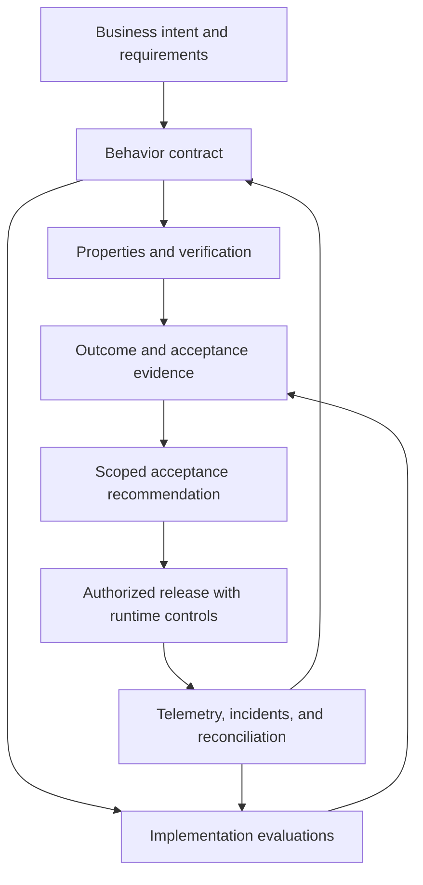
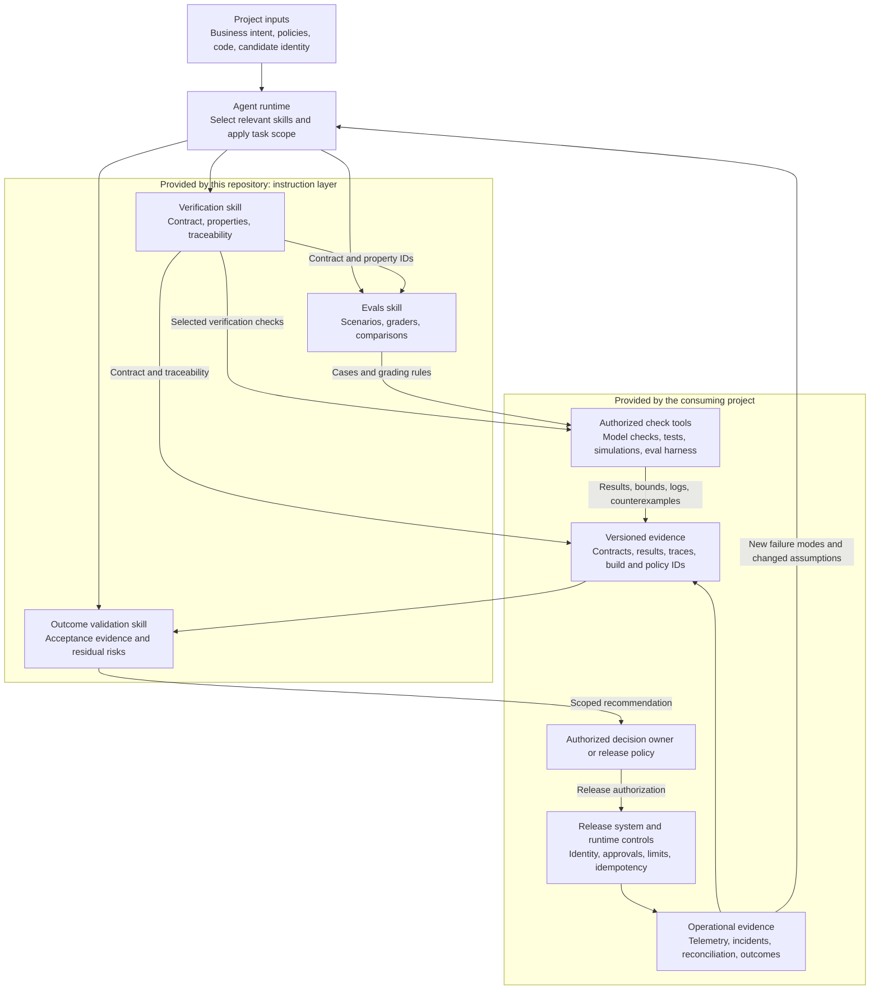
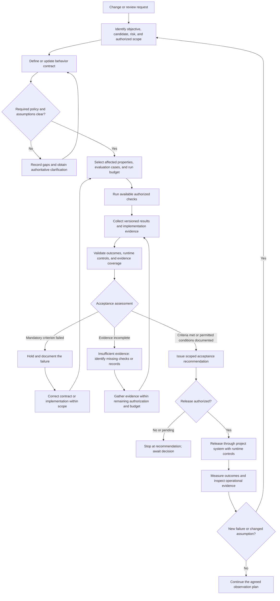

# Agent Skills for Software Factory Assurance

Reusable agent skills for Claude and Codex to define correct behavior, evaluate implemented workflows, and validate business outcomes in AI-assisted software delivery.

This repository helps engineering teams move from “the code was generated and the tests passed” to a more precise question: **what evidence shows that this version of the system preserves the required behavior and achieves the intended result?**

The collection is based on Bijit Ghosh's article, **“Formally Verified, Still Unsafe. Specification Gaps and Residual Risk in Agentic Software.”**

## Contents

- [What this repository provides](#what-this-repository-provides)
- [Choose a skill](#choose-a-skill)
- [Repository structure](#repository-structure)
- [Installation and first use](#installation-and-first-use)
- [The assurance workflow](#the-assurance-workflow)
- [Architecture and execution flow](#architecture-and-execution-flow)
- [Skill guides and example prompts](#skill-guides-and-example-prompts)
- [Worked example: refund processing](#worked-example-refund-processing)
- [Evidence and decision standards](#evidence-and-decision-standards)
- [Using the skills in a delivery pipeline](#using-the-skills-in-a-delivery-pipeline)
- [Limitations and validation status](#limitations-and-validation-status)
- [Contributing](#contributing)
- [Background and attribution](#background-and-attribution)

## What this repository provides

The repository contains three instruction-based skills. Each includes a `SKILL.md` entry point, supporting reference guidance, and `agents/openai.yaml` metadata for the Codex UI. The workflow instructions and supporting references are shared across clients.

They guide an agent through assurance tasks using the requirements, code, tools, and evidence available in the target project. They can be used independently or together.

**The repository does not currently include an executable model checker, evaluation harness, CI workflow, production policy engine, or sample application.** When a skill calls for a check, the agent must use the project's available tooling, create appropriate project-specific artifacts within the task scope, or clearly report that the check was not run.

Intended users include platform engineers, engineering leads, architects, agent developers, reliability teams, and reviewers responsible for consequential software changes.

### Core principles

- A valid proof can still describe the wrong business requirement.
- Safety and liveness require separate attention: preventing an unsafe action does not establish that a valid request will finish.
- Empirical evaluations establish observed behavior within a sample and environment, not universal guarantees.
- Evidence must identify the model, implementation, policy, configuration, and deployment it actually covers.
- Runtime controls and operational feedback remain necessary after pre-release checks.
- Verification depth should follow failure impact, reversibility, and exposure.
- An agent's release recommendation is distinct from an authorized approval or deployment action.

## Choose a skill

| Skill | Main question | Typical outputs |
|---|---|---|
| [Software Factory Verification](software-factory-verification/SKILL.md) | What must remain true, and what evidence checks those properties? | Behavior contract, property map, verification results, counterexamples, specification gaps |
| [Software Factory Evals](software-factory-evals/SKILL.md) | How does the implementation behave across representative and adverse scenarios? | Case manifest, grading rules, run evidence, candidate/baseline comparison, regression cases |
| [Software Factory Outcome Validation](software-factory-outcome-validation/SKILL.md) | Did the delivered behavior meet the intended outcome, and is acceptance justified? | Acceptance evidence ledger, runtime-control assessment, residual-risk register, scoped recommendation |

Start with **verification** when requirements or workflow behavior are unclear. Start with **evals** when the contract exists and you need to assess an implementation. Start with **outcome validation** when you have a candidate or deployment and need to assess acceptance evidence.

Routine low-risk edits do not require the complete three-skill workflow.

## Repository structure

```text
Agent-Skills/
├── README.md
├── software-factory-verification/
│   ├── SKILL.md
│   ├── agents/
│   │   └── openai.yaml
│   └── references/
│       └── verification-record.md
├── software-factory-evals/
│   ├── SKILL.md
│   ├── agents/
│   │   └── openai.yaml
│   └── references/
│       └── eval-design.md
└── software-factory-outcome-validation/
    ├── SKILL.md
    ├── agents/
    │   └── openai.yaml
    └── references/
        └── outcome-record.md
```

The entry points describe when and how to use each skill. Supporting references supply record fields, examples, and decision guidance when needed; they are not executable schemas.

## Installation and first use

The shared `SKILL.md` instructions and references are written for both Claude and Codex. Choose the installation method for your client. The `agents/openai.yaml` files provide Codex-specific UI metadata; they are not required to understand or apply the workflow in Claude.

### Claude Code

Clone this repository, then copy the three complete skill folders into either:

- `~/.claude/skills/` for personal use across projects.
- `.claude/skills/` inside your target project for project-scoped use.

Each destination must contain `<skill-name>/SKILL.md` and its supporting references. On Windows, the personal location is under `%USERPROFILE%\.claude\skills`.

Invoke the installed skills with:

```text
/software-factory-verification Assess this project's critical workflow.
/software-factory-evals Evaluate the candidate against the behavior contract.
/software-factory-outcome-validation Review the release acceptance evidence.
```

These are three separate example requests. Claude Code can also select relevant skills automatically. Installation and invocation follow the [official Claude Code skills documentation](https://code.claude.com/docs/en/skills).

### Claude web or desktop

Package each skill folder as its own ZIP, preserving `SKILL.md` and `references/`. In Claude, go to **Customize > Skills**, choose **+ Create skill > Upload a skill**, upload each ZIP, and enable it. Code execution/file creation and any required organization permissions must be enabled.

Then ask, for example:

```text
Use the software-factory-verification skill to assess the attached workflow.
Identify missing evidence and distinguish proposed checks from executed checks.
```

Uploading a skill does not provide access to your local repository or CI tools. Supply the required artifacts or connect authorized tools; checks without execution access must be reported as not run. See [Claude's custom skill instructions](https://support.claude.com/en/articles/12512180-use-skills-in-claude) for current interface and account requirements.

### Codex

In an environment with the bundled `skill-installer` skill, request:

```text
Use $skill-installer to install these skills from bijit-ghosh/Agent-Skills:
- software-factory-verification
- software-factory-evals
- software-factory-outcome-validation
```

Alternatively, copy the three complete skill folders to `$CODEX_HOME/skills`, or `~/.codex/skills` when no custom location is configured. On Windows, the default directory is under `%USERPROFILE%\.codex\skills`.

Invoke a skill with `$software-factory-verification`, `$software-factory-evals`, or `$software-factory-outcome-validation` in your request.

### Shared setup checks

Download or clone the repository before manual installation:

```bash
git clone https://github.com/bijit-ghosh/Agent-Skills.git
```

Copy the individual skill folders, not the entire repository as one skill. Preserve their supporting references. If a destination already exists, review local changes before updating it.

GitHub publication does not install skills in any client. After installation, invoke a skill and confirm the client loads its `SKILL.md`. Check the destination and folder nesting if it cannot find the skill.

The installation instructions follow the respective client conventions. This repository does not yet publish end-to-end execution results for each client; portability of the instructions is not a claim of identical tool access or behavior.

### Give the agent a concrete target

A useful starting request identifies:

| Input | Why it matters |
|---|---|
| Workflow and business objective | Defines what success means |
| Repository, branch, and candidate revision | Establishes the implementation under assessment |
| Authoritative requirements and policies | Prevents the agent from inventing acceptance rules |
| Known incidents or failure scenarios | Focuses coverage on demonstrated risk |
| Available test, model, and telemetry tools | Determines what can actually be checked |
| Allowed environments and side effects | Bounds execution |
| Time, cost, and run limits | Makes stopping conditions explicit |
| Desired deliverables | Separates a design exercise from an executed evaluation |

The skills should identify missing material and distinguish proposed criteria from approved requirements.

## The assurance workflow



The diagram describes a process to implement in a project. These stages are not automatically orchestrated by this repository.

1. **Define intent.** Establish objectives, constraints, permitted actions, and unacceptable outcomes.
2. **Make behavior explicit.** Describe states, transitions, guards, authorization, approvals, safety properties, and liveness assumptions.
3. **Select and execute checks.** Match verification techniques and evaluations to the relevant failure modes.
4. **Assemble evidence.** Connect results to requirement IDs and exact artifact versions.
5. **Assess acceptance.** Separate demonstrated success, known failures, and insufficient evidence.
6. **Observe and improve.** Feed incidents and counterexamples back into the contract, tests, models, and runtime controls.

## Architecture and execution flow

This is a reference architecture for applying the skills in a software factory. **The skill instructions are provided by this repository; the agent runtime, project tools, evidence storage, release system, and production controls are supplied by the consuming project.** Arrows describe information and decision flow, not prebuilt integrations.

### Component architecture



The same agent can apply all three skills sequentially. Separate agents or an orchestration service are optional implementation choices, not requirements of this collection.

| Component | Responsibility | Boundary |
|---|---|---|
| Project inputs | Supply authoritative intent, constraints, and the exact candidate | Missing policy is unresolved, not invented |
| Agent runtime | Read the relevant skill and coordinate the requested work | Operates within existing permissions and resource limits |
| Verification skill | Define properties and connect them to implementation and checks | Model correctness does not establish implementation correctness |
| Evals skill | Assess implemented behavior using scenarios and explicit graders | Observed success is limited by coverage and sample size |
| Project check tools | Execute checks and expose reproducible results | Unavailable tools produce a not-run or inconclusive result |
| Evidence records | Preserve versions, assumptions, traces, and result provenance | No database or evidence service is bundled here |
| Outcome validation skill | Assess business acceptance and residual risk | Recommendation does not grant release authority |
| Decision owner and release system | Apply actual release policy and authorization | Mandatory failed gates cannot be waived by an aggregate score |
| Runtime controls and telemetry | Constrain execution and observe actual outcomes | Operational failures feed back into assurance work |

### Execution and decision flow



Rework and evidence collection are bounded loops. Stop when the agreed budget is exhausted, repeated attempts produce no new evidence, an external side effect is uncertain, or additional authorization is required. Record the remaining gap instead of treating repeated retries as progress.

### What moves between the skills

1. **Verification to evals:** requirement IDs, state transitions, safety and liveness properties, assumptions, and known counterexample traces.
2. **Checks to outcome validation:** actual run results, tested candidate identity, coverage limits, grader definitions, failure traces, and runtime-control evidence.
3. **Outcome validation to the decision owner:** criterion-level findings, residual risks, proposed conditions, and an acceptance recommendation.
4. **Production back to verification and evals:** incidents, reconciliation failures, policy changes, and observed outcomes that require a revised contract or new regression case.

For example, a timeout-after-commit incident becomes a duplicate-effect property, a controlled fault-injection scenario, and an acceptance criterion backed by durable payment and reconciliation evidence. Each artifact refers to the same intended operation and the relevant implementation and policy versions.

## Skill guides and example prompts

The prompts below use client-neutral skill names. In Claude Code, invoke the matching `/skill-name` command and supply the rest of the request. In Codex, prefix the skill name with `# Agent Skills for Software Factory Assurance

Reusable agent skills for Claude and Codex to define correct behavior, evaluate implemented workflows, and validate business outcomes in AI-assisted software delivery.

This repository helps engineering teams move from “the code was generated and the tests passed” to a more precise question: **what evidence shows that this version of the system preserves the required behavior and achieves the intended result?**

The collection is based on Bijit Ghosh's article, **“Formally Verified, Still Unsafe. Specification Gaps and Residual Risk in Agentic Software.”**

## Contents

- [What this repository provides](#what-this-repository-provides)
- [Choose a skill](#choose-a-skill)
- [Repository structure](#repository-structure)
- [Installation and first use](#installation-and-first-use)
- [The assurance workflow](#the-assurance-workflow)
- [Architecture and execution flow](#architecture-and-execution-flow)
- [Skill guides and example prompts](#skill-guides-and-example-prompts)
- [Worked example: refund processing](#worked-example-refund-processing)
- [Evidence and decision standards](#evidence-and-decision-standards)
- [Using the skills in a delivery pipeline](#using-the-skills-in-a-delivery-pipeline)
- [Limitations and validation status](#limitations-and-validation-status)
- [Contributing](#contributing)
- [Background and attribution](#background-and-attribution)

## What this repository provides

The repository contains three instruction-based skills. Each includes a `SKILL.md` entry point, supporting reference guidance, and `agents/openai.yaml` UI metadata.

They guide an agent through assurance tasks using the requirements, code, tools, and evidence available in the target project. They can be used independently or together.

**The repository does not currently include an executable model checker, evaluation harness, CI workflow, production policy engine, or sample application.** When a skill calls for a check, the agent must use the project's available tooling, create appropriate project-specific artifacts within the task scope, or clearly report that the check was not run.

Intended users include platform engineers, engineering leads, architects, agent developers, reliability teams, and reviewers responsible for consequential software changes.

### Core principles

- A valid proof can still describe the wrong business requirement.
- Safety and liveness require separate attention: preventing an unsafe action does not establish that a valid request will finish.
- Empirical evaluations establish observed behavior within a sample and environment, not universal guarantees.
- Evidence must identify the model, implementation, policy, configuration, and deployment it actually covers.
- Runtime controls and operational feedback remain necessary after pre-release checks.
- Verification depth should follow failure impact, reversibility, and exposure.
- An agent's release recommendation is distinct from an authorized approval or deployment action.

## Choose a skill

| Skill | Main question | Typical outputs |
|---|---|---|
| [Software Factory Verification](software-factory-verification/SKILL.md) | What must remain true, and what evidence checks those properties? | Behavior contract, property map, verification results, counterexamples, specification gaps |
| [Software Factory Evals](software-factory-evals/SKILL.md) | How does the implementation behave across representative and adverse scenarios? | Case manifest, grading rules, run evidence, candidate/baseline comparison, regression cases |
| [Software Factory Outcome Validation](software-factory-outcome-validation/SKILL.md) | Did the delivered behavior meet the intended outcome, and is acceptance justified? | Acceptance evidence ledger, runtime-control assessment, residual-risk register, scoped recommendation |

Start with **verification** when requirements or workflow behavior are unclear. Start with **evals** when the contract exists and you need to assess an implementation. Start with **outcome validation** when you have a candidate or deployment and need to assess acceptance evidence.

Routine low-risk edits do not require the complete three-skill workflow.

## Repository structure

```text
Agent-Skills/
├── README.md
├── software-factory-verification/
│   ├── SKILL.md
│   ├── agents/
│   │   └── openai.yaml
│   └── references/
│       └── verification-record.md
├── software-factory-evals/
│   ├── SKILL.md
│   ├── agents/
│   │   └── openai.yaml
│   └── references/
│       └── eval-design.md
└── software-factory-outcome-validation/
    ├── SKILL.md
    ├── agents/
    │   └── openai.yaml
    └── references/
        └── outcome-record.md
```

The entry points describe when and how to use each skill. Supporting references supply record fields, examples, and decision guidance when needed; they are not executable schemas.

## Installation and first use

The shared `SKILL.md` instructions and references are written for both Claude and Codex. Choose the installation method for your client. The `agents/openai.yaml` files provide Codex-specific UI metadata; they are not required to understand or apply the workflow in Claude.

### Claude Code

Clone this repository, then copy the three complete skill folders into either:

- `~/.claude/skills/` for personal use across projects.
- `.claude/skills/` inside your target project for project-scoped use.

Each destination must contain `<skill-name>/SKILL.md` and its supporting references. On Windows, the personal location is under `%USERPROFILE%\.claude\skills`.

Invoke the installed skills with:

```text
/software-factory-verification Assess this project's critical workflow.
/software-factory-evals Evaluate the candidate against the behavior contract.
/software-factory-outcome-validation Review the release acceptance evidence.
```

These are three separate example requests. Claude Code can also select relevant skills automatically. Installation and invocation follow the [official Claude Code skills documentation](https://code.claude.com/docs/en/skills).

### Claude web or desktop

Package each skill folder as its own ZIP, preserving `SKILL.md` and `references/`. In Claude, go to **Customize > Skills**, choose **+ Create skill > Upload a skill**, upload each ZIP, and enable it. Code execution/file creation and any required organization permissions must be enabled.

Then ask, for example:

```text
Use the software-factory-verification skill to assess the attached workflow.
Identify missing evidence and distinguish proposed checks from executed checks.
```

Uploading a skill does not provide access to your local repository or CI tools. Supply the required artifacts or connect authorized tools; checks without execution access must be reported as not run. See [Claude's custom skill instructions](https://support.claude.com/en/articles/12512180-use-skills-in-claude) for current interface and account requirements.

### Codex

In an environment with the bundled `skill-installer` skill, request:

```text
Use $skill-installer to install these skills from bijit-ghosh/Agent-Skills:
- software-factory-verification
- software-factory-evals
- software-factory-outcome-validation
```

Alternatively, copy the three complete skill folders to `$CODEX_HOME/skills`, or `~/.codex/skills` when no custom location is configured. On Windows, the default directory is under `%USERPROFILE%\.codex\skills`.

Invoke a skill with `$software-factory-verification`, `$software-factory-evals`, or `$software-factory-outcome-validation` in your request.

### Shared setup checks

Download or clone the repository before manual installation:

```bash
git clone https://github.com/bijit-ghosh/Agent-Skills.git
```

Copy the individual skill folders, not the entire repository as one skill. Preserve their supporting references. If a destination already exists, review local changes before updating it.

GitHub publication does not install skills in any client. After installation, invoke a skill and confirm the client loads its `SKILL.md`. Check the destination and folder nesting if it cannot find the skill.

The installation instructions follow the respective client conventions. This repository does not yet publish end-to-end execution results for each client; portability of the instructions is not a claim of identical tool access or behavior.

### Give the agent a concrete target

A useful starting request identifies:

| Input | Why it matters |
|---|---|
| Workflow and business objective | Defines what success means |
| Repository, branch, and candidate revision | Establishes the implementation under assessment |
| Authoritative requirements and policies | Prevents the agent from inventing acceptance rules |
| Known incidents or failure scenarios | Focuses coverage on demonstrated risk |
| Available test, model, and telemetry tools | Determines what can actually be checked |
| Allowed environments and side effects | Bounds execution |
| Time, cost, and run limits | Makes stopping conditions explicit |
| Desired deliverables | Separates a design exercise from an executed evaluation |

The skills should identify missing material and distinguish proposed criteria from approved requirements.

## The assurance workflow


The diagram describes a process to implement in a project. These stages are not automatically orchestrated by this repository.

1. **Define intent.** Establish objectives, constraints, permitted actions, and unacceptable outcomes.
2. **Make behavior explicit.** Describe states, transitions, guards, authorization, approvals, safety properties, and liveness assumptions.
3. **Select and execute checks.** Match verification techniques and evaluations to the relevant failure modes.
4. **Assemble evidence.** Connect results to requirement IDs and exact artifact versions.
5. **Assess acceptance.** Separate demonstrated success, known failures, and insufficient evidence.
6. **Observe and improve.** Feed incidents and counterexamples back into the contract, tests, models, and runtime controls.

## Architecture and execution flow

This is a reference architecture for applying the skills in a software factory. **The skill instructions are provided by this repository; the agent runtime, project tools, evidence storage, release system, and production controls are supplied by the consuming project.** Arrows describe information and decision flow, not prebuilt integrations.

### Component architecture


The same agent can apply all three skills sequentially. Separate agents or an orchestration service are optional implementation choices, not requirements of this collection.

| Component | Responsibility | Boundary |
|---|---|---|
| Project inputs | Supply authoritative intent, constraints, and the exact candidate | Missing policy is unresolved, not invented |
| Agent runtime | Read the relevant skill and coordinate the requested work | Operates within existing permissions and resource limits |
| Verification skill | Define properties and connect them to implementation and checks | Model correctness does not establish implementation correctness |
| Evals skill | Assess implemented behavior using scenarios and explicit graders | Observed success is limited by coverage and sample size |
| Project check tools | Execute checks and expose reproducible results | Unavailable tools produce a not-run or inconclusive result |
| Evidence records | Preserve versions, assumptions, traces, and result provenance | No database or evidence service is bundled here |
| Outcome validation skill | Assess business acceptance and residual risk | Recommendation does not grant release authority |
| Decision owner and release system | Apply actual release policy and authorization | Mandatory failed gates cannot be waived by an aggregate score |
| Runtime controls and telemetry | Constrain execution and observe actual outcomes | Operational failures feed back into assurance work |

### Execution and decision flow


Rework and evidence collection are bounded loops. Stop when the agreed budget is exhausted, repeated attempts produce no new evidence, an external side effect is uncertain, or additional authorization is required. Record the remaining gap instead of treating repeated retries as progress.

### What moves between the skills

1. **Verification to evals:** requirement IDs, state transitions, safety and liveness properties, assumptions, and known counterexample traces.
2. **Checks to outcome validation:** actual run results, tested candidate identity, coverage limits, grader definitions, failure traces, and runtime-control evidence.
3. **Outcome validation to the decision owner:** criterion-level findings, residual risks, proposed conditions, and an acceptance recommendation.
4. **Production back to verification and evals:** incidents, reconciliation failures, policy changes, and observed outcomes that require a revised contract or new regression case.

For example, a timeout-after-commit incident becomes a duplicate-effect property, a controlled fault-injection scenario, and an acceptance criterion backed by durable payment and reconciliation evidence. Each artifact refers to the same intended operation and the relevant implementation and policy versions.

. In Claude web or desktop, name the enabled skill in your message.

### 1. Software Factory Verification

Use this skill for behavior-contract design, specification-gap analysis, verification planning, and impact analysis after a critical change.

It examines legal transitions, side effects, identity and authorization, approval validity, retry behavior, concurrency, and recovery. It distinguishes the model from the deployed implementation and records the scope of every result.

**Typical deliverables**

- Versioned behavior contract and stable requirement/property IDs.
- Safety and liveness properties with explicit assumptions.
- Property-to-transition-to-source traceability.
- Executed check results, bounds, logs, and counterexamples.
- Specification gaps and residual risks.

**Example request**

```text
Use the software-factory-verification to assess the refund workflow in this
repository at the candidate revision I provided.

Use the existing refund policy as authoritative. Inspect retry workers,
callbacks, authorization checks, and the payment integration. Define safety
and liveness properties and map them to implementation paths.

Run relevant checks available in the local test environment. Report checks
that cannot be run, and do not call the live payment service.
```

Read the [verification record guidance](software-factory-verification/references/verification-record.md) for contract fields, evidence metadata, and the refund stress example.

### 2. Software Factory Evals

Use this skill to design and execute behavioral evaluations, compare a candidate against a baseline, assess graders, and turn failures into regression cases.

It separates task success, critical policy violations, semantic quality, recovery, and efficiency. It calls for held-out evaluation cases, appropriate repetition for stochastic behavior, and explicit reporting of harness failures and uncertainty.

**Typical deliverables**

- Versioned case manifest linked to requirements and properties.
- Deterministic assertions and semantic grading rubrics where needed.
- Project-specific harness or configuration when supported.
- Raw run evidence, final-state observations, and sanitized failure traces.
- Candidate/baseline comparison with counts, variability, and coverage limits.

**Example request**

```text
Use the software-factory-evals to compare the candidate refund agent with the
baseline using the supplied behavior contract.

Include timeout-after-commit, concurrent workers, stale approval, delayed
callbacks, and dependency recovery. Grade durable payment effects and
terminal workflow state, not only the agent's final message.

Use synthetic fixtures and a declared run budget. Keep development cases
separate from held-out cases and report critical violations independently
of the aggregate task-completion score.
```

Read the [evaluation design guidance](software-factory-evals/references/eval-design.md) for case fields, grading dimensions, and comparison reporting.

### 3. Software Factory Outcome Validation

Use this skill for acceptance reviews, release-evidence assessment, runtime-control validation, and authorized post-release measurement.

It checks whether the observed result meets the intended business outcome and whether the evidence applies to the actual candidate or deployment. It distinguishes configured controls from exercised controls and risk recommendations from recorded acceptance decisions.

**Typical deliverables**

- Objective-to-evidence ledger with criterion-level results.
- Candidate/deployment identity and evidence-freshness assessment.
- Runtime-control findings and business-outcome measurements.
- Residual risks, accountable owners, and missing evidence.
- Accept, accept with conditions, hold, or insufficient-evidence recommendation.

**Example request**

```text
Use the software-factory-outcome-validation to review this release candidate.

Use the supplied acceptance criteria, verification results, evaluation
runs, deployment manifest, and reconciliation evidence. Check that they
refer to the same candidate and policy version.

Assess intended outcomes and mandatory guardrails separately. Recommend
a decision, list residual risks and missing evidence, and distinguish
your recommendation from an authorized release approval.
```

Read the [outcome record guidance](software-factory-outcome-validation/references/outcome-record.md) for the evidence ledger and decision semantics.

## Worked example: refund processing

Suppose a project requires automatic refunds below a defined threshold and valid human approval above it. The threshold is a project policy input; the article's $100 example is not a default imposed by these skills.

A request can pass ordinary success-path tests and still produce an incorrect outcome:

1. A worker submits a refund.
2. The external service commits the payment.
3. The response is lost.
4. The worker treats the timeout as a failed transaction.
5. A retry creates a second committed refund.

The assurance question is not simply whether the retry function works. It is whether the workflow prevents duplicate committed effects while resolving uncertain outcomes.

| Stage | What to investigate | Evidence to seek |
|---|---|---|
| Verification | Approval binding, uncertain payment state, concurrency, idempotency retention, terminal states | Contract, properties, transition/source map, checked traces |
| Evals | Lost response after commit, two workers, delayed callbacks, changed approval parameters | Controlled fault scenarios, durable effect counts, observed state transitions |
| Outcome validation | Correct customer and amount, duplicate effects, reconciliation, resolution time | Acceptance ledger, external-state evidence, guardrail results |

A possible safety property is **at most one committed refund effect per intended operation**. This allows multiple safe API attempts; counting client calls alone does not establish the property.

A possible liveness property is **every valid request eventually completes, is rejected, is cancelled, or is escalated under the specified availability and scheduling assumptions**. Whether escalation counts as business success must be defined separately.

If the candidate passes all executed cases but the downstream service's idempotency retention is unknown, that uncertainty belongs in the evidence record. It cannot be converted into a guarantee.

## Evidence and decision standards

### Traceability

Use stable identifiers to connect:

```text
Business requirement
  -> behavior property
  -> state transition
  -> implementation location
  -> check or evaluation case
  -> runtime control
  -> candidate or deployment artifact
```

For each important result, capture the relevant code/build identity, model and policy versions, configuration, tool version, execution environment, timestamp, assumptions, bounds, and evidence location.

Not every field applies to every task. Missing relevant identity or provenance limits the claim that can be made.

### Result vocabulary

| Result | Meaning |
|---|---|
| Passed | The executed check met its criterion within its stated scope |
| Failed | Evidence demonstrates a violated criterion |
| Inconclusive / unknown | The available result cannot establish the required conclusion |
| Not run | A check was designed or requested but was not executed |
| Not applicable | The criterion does not apply, with a recorded reason |

Do not treat a timeout, skipped check, missing trace, or mismatched build as a pass.

### Acceptance recommendations

| Recommendation | When it is appropriate |
|---|---|
| Accept | Applicable mandatory criteria have adequate evidence and no assessed blocking condition remains |
| Accept with conditions | Permissible gaps have authorized acceptance and explicit follow-up conditions; otherwise label it proposed |
| Hold | A mandatory criterion is unmet or a blocking defect is demonstrated |
| Insufficient evidence | The evidence cannot support the requested conclusion |

A strong average score cannot cancel a failed mandatory guardrail. A release recommendation does not itself authorize deployment, live transactions, rollback, or business-risk acceptance.

## Using the skills in a delivery pipeline

The following is an integration pattern for teams to implement, not a bundled CI feature:

| Trigger | Suggested activity |
|---|---|
| Requirement or business-policy change | Revisit the behavior contract and affected properties |
| New execution path or retry mechanism | Inspect transition coverage, authorization, and duplicate-effect risk |
| Agent model, prompt, or tool change | Run relevant behavioral and regression evaluations |
| Release candidate creation | Bind evidence to the exact build and assess acceptance |
| Production incident or reconciliation failure | Reproduce the trace and update properties, tests, or controls |
| Post-release measurement window | Compare actual business outcomes and guardrails to declared criteria |

Use existing project formats and tools rather than creating competing sources of truth. Select checks by impact analysis, then broaden coverage when failures or unresolved risks justify it.

For critical workflows, consider evidence across five layers:

1. **Design constraints:** contracts, types, schemas, and architectural boundaries.
2. **Behavior verification:** properties, state transitions, and concurrency analysis.
3. **Empirical validation:** tests, evaluations, simulations, and fault injection.
4. **Runtime enforcement:** scoped identity, approvals, limits, and idempotency.
5. **Telemetry and feedback:** traces, incidents, reconciliation, and recovery evidence.

## Limitations and validation status

- The three skills passed the bundled skill-creator structural validator during initial creation. The original run logs and validator version are not published here, so this is a reported creation-time check rather than independently reproducible evidence of that historical run. Structural validation checks packaging and instruction-file conventions; it does not demonstrate effectiveness on production systems.
- The repository does not currently publish a behavioral benchmark, production certification, or measured defect-reduction claim.
- Formal results cover the stated properties and assumptions. Bounded exploration remains bounded.
- Evaluation results depend on case selection, grader quality, environment fidelity, and sample size.
- A correct model can diverge from implementation. Evidence must be revisited when relevant code, dependencies, policies, prompts, tools, or configuration change.
- Business success cannot be inferred solely from green tests or technically valid actions.
- Execution requires the target project's tools and access. The skills do not grant credentials or expand authorization.
- No fixed model provider, verification language, evaluation framework, or CI platform is required by these instructions.

## Contributing

Useful contributions improve a demonstrated assurance decision or make an existing workflow easier to apply.

When proposing a change:

1. Identify the skill and concrete scenario it improves.
2. Explain the observed gap or ambiguous instruction.
3. Keep the change aligned with that skill's scope.
4. Update supporting references when the evidence format or workflow changes.
5. Exercise the guidance on a representative scenario when feasible and report what was actually tested.

Avoid adding universal requirements from a single example, duplicating the same guidance across all three skills, or describing planned tooling as implemented functionality.

If the Codex skill-creator validator is available in your environment, run its `scripts/quick_validate.py` against each changed skill directory. For example, from the repository root, replace the validator path with the one in your installation:

```bash
python /path/to/skill-creator/scripts/quick_validate.py ./software-factory-verification
python /path/to/skill-creator/scripts/quick_validate.py ./software-factory-evals
python /path/to/skill-creator/scripts/quick_validate.py ./software-factory-outcome-validation
```

That validator belongs to the local skill-creator installation; it is not included in this repository. Supplement structural checks with realistic task-based review when the change affects behavior.

## Background and attribution

**Author/source context:** Bijit Ghosh, “Formally Verified, Still Unsafe. Specification Gaps and Residual Risk in Agentic Software.”

The source was supplied as article text; a verified publication URL is not included in this repository.

The article's central distinction is that proving selected properties does not establish that the specification captures the right business intent. These skills translate that distinction into behavior contracts, empirical evaluations, evidence traceability, runtime-control assessment, and outcome validation.

Dataset separation, grader calibration, statistical reporting, and the acceptance-ledger format are practical extensions used to make the assurance workflow actionable.
