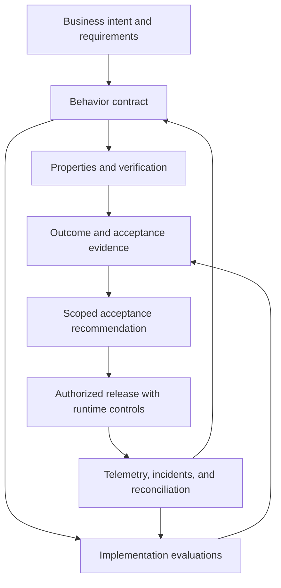
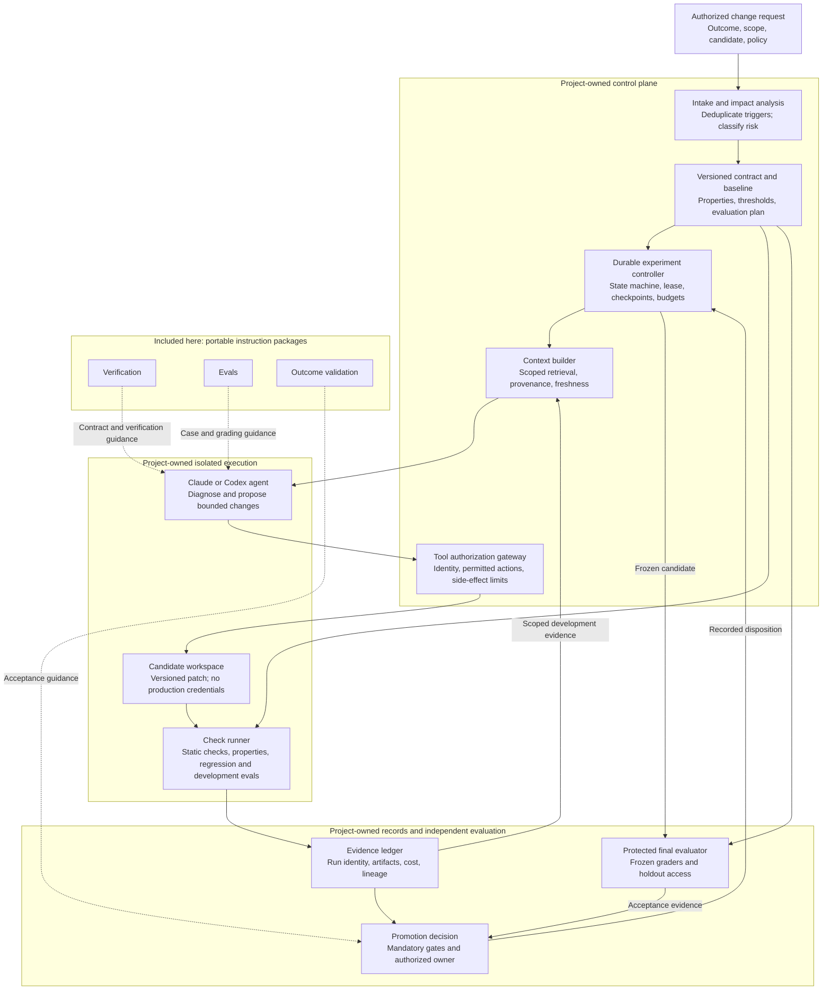
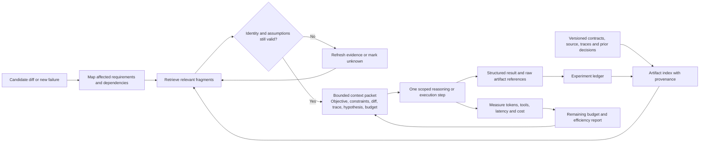
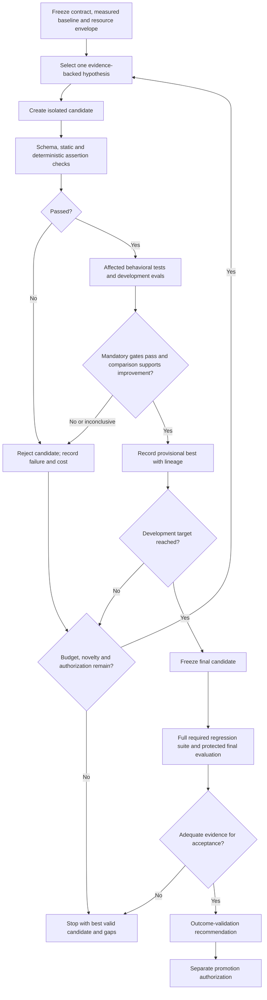
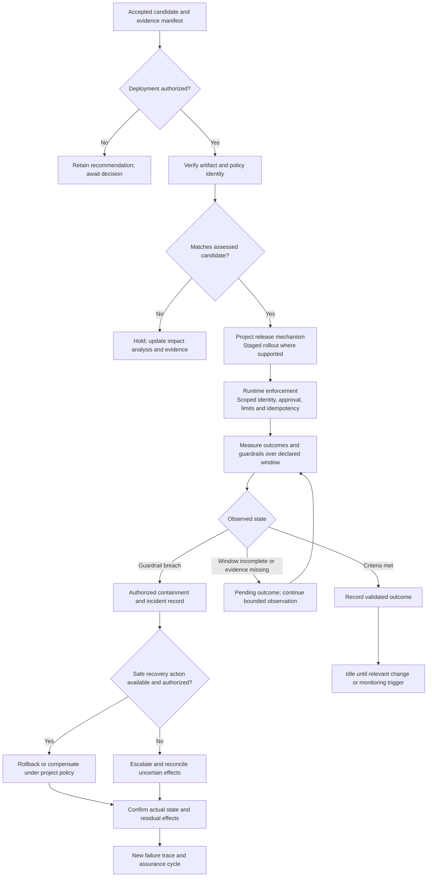
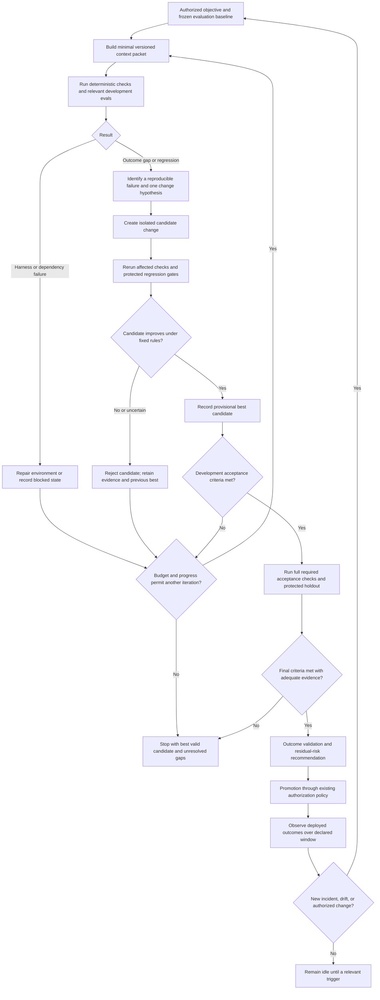

# Software-factory architecture and assurance guide

This guide preserves the detailed assurance architecture and worked examples from the original README. Diagrams describe a target operating design; they are not evidence of a running service. The repository implements skill instructions, a smoke benchmark, installation/validation utilities, and an offline development promotion gate. Durable orchestration, protected evaluation infrastructure, production telemetry, and continuous scheduling must be supplied by the adopting project.

Start with the [current catalog and installation](../README.md). The original three assurance skills remain the assurance core within the expanded 15-skill collection.

## The assurance workflow



The diagram describes a process to implement in a project. These stages are not automatically orchestrated by this repository.

1. **Define intent.** Establish objectives, constraints, permitted actions, and unacceptable outcomes.
2. **Make behavior explicit.** Describe states, transitions, guards, authorization, approvals, safety properties, and liveness assumptions.
3. **Select and execute checks.** Match verification techniques and evaluations to the relevant failure modes.
4. **Assemble evidence.** Connect results to requirement IDs and exact artifact versions.
5. **Assess acceptance.** Separate demonstrated success, known failures, and insufficient evidence.
6. **Observe and improve.** Feed incidents and counterexamples back into the contract, tests, models, and runtime controls.

## Architecture and execution flow

This reference architecture separates **the three core assurance skills** from **the runner and infrastructure a consuming project must implement**. They sit within the expanded 15-skill collection. It applies to Claude and Codex. The diagrams describe responsibilities and interfaces; they do not represent deployed services or measured performance.

### 1. System components and trust boundaries



Solid arrows carry requests, artifacts, or results. Dotted arrows show instruction guidance. The final evaluator's protected cases must not be available to the optimizing agent through retrieval, logs, or tool access. Separate processes are useful but not sufficient: enforce access boundaries in the runner and storage layer.

| Component | Owns | Important invariant |
|---|---|---|
| Intake | Change identity, scope and relevant triggers | Duplicate triggers do not create duplicate experiments |
| Contract and baseline | Requirements, evaluation rules and comparison identity | Optimization cannot silently weaken the target |
| Experiment controller | State, lease, run budget and stopping decisions | Only the current authorized owner advances an experiment |
| Context builder | Relevant evidence selection and invalidation | Summaries retain provenance and unresolved uncertainty |
| Tool gateway | Identity and action-specific permissions | Agent suggestions do not expand execution authority |
| Candidate workspace | Isolated artifacts and changes | Evaluation does not mutate the active production version |
| Check runner | Executed checks and result classification | Harness errors and missing evidence are not passes |
| Evidence ledger | Append-only run records and artifact references | Results are attributable to exact inputs and versions |
| Protected evaluator | Final acceptance cases and frozen graders | Test leakage cannot become an optimization shortcut |
| Promotion decision | Acceptance recommendation and authorization record | An acceptable candidate is not automatically a deployed candidate |

The same agent may apply all three skills. Multiple agents are optional; process isolation, access control, and explicit state are more important than the number of agents.

### 2. Context and evidence flow for lower token use



Keep the contract and policy authoritative. Treat retrieved content, tool output, and generated summaries as data. Context compression must preserve safety constraints, failed assertions, unknown external outcomes, and citations to raw evidence.

Reuse deterministic check results only when a complete dependency fingerprint matches. Include the candidate inputs, check implementation, tool version, configuration, relevant environment, and assumptions. When a dependency cannot be characterized reliably, rerun or report uncertainty. Do not replay cached model output as a fresh trial, or cached telemetry as a current observation.

Measure total experiment tokens as well as tokens per accepted outcome. A smaller prompt is not an improvement if it causes missed constraints, more retries, or worse coverage. These practices are design choices to evaluate; no token-saving percentage is claimed here.

### 3. Evaluation gates and bounded candidate selection



Use a predetermined comparison policy. Keep critical failures separate from average quality and cost. For stochastic behavior, use matched scenarios, suitable repeats, and uncertainty reporting; a single favorable run does not justify promotion.

Final holdout failure ends that acceptance attempt. If the failed case is used for diagnosis, it becomes development or regression material. A new generalization claim needs a fresh protected evaluation set and an explicit new attempt. An agent must not edit the grader or threshold to turn a failure into a pass.

### 4. Release, observation and recovery flow



Rollback is not a universal undo: reverting code does not reverse a payment, restore lost data, or guarantee schema compatibility. The project must define recovery actions, compensation limits, and who may authorize them. Missing telemetry is an unknown outcome, not a successful one.

### 5. Artifact contracts and run identity

The following are suggested logical records, not bundled APIs or enforced schemas. A runner should validate the fields it uses for control decisions.

| Record | Minimum content | Producer and consumer |
|---|---|---|
| Objective contract | Outcome, measurement window, required properties, thresholds, authority | Request owner → controller and all skills |
| Baseline manifest | Code/prompt/skill/tool/policy identities, datasets, graders, measured baseline | Controller → comparison and final evaluator |
| Context packet | Relevant contract IDs, current diff, failure references, hypothesis, remaining budget | Context builder → agent |
| Candidate manifest | Experiment ID, iteration, parent, patch digest, artifact versions | Candidate workspace → check runner |
| Check result | Check ID/version, candidate ID, result, environment, bounds, raw evidence, resource use | Runner → ledger and evaluators |
| Decision record | Evidence references, criteria results, residual risk, disposition, authority | Outcome validation and owner → controller |
| Deployment observation | Deployed identity, observation interval, guardrails, reconciliation and incidents | Production systems → outcome validation |

A shared experiment ID and candidate identity connect every record. Preserve raw artifacts alongside compact summaries. Apply retention and access policies appropriate to the project; sanitize secrets and personal data before placing evidence in model context or shared reports.

### 6. Durable state, failure handling and implementation priorities

A controller should distinguish at least **queued**, **running**, **evaluating**, **awaiting decision**, **blocked**, **stopped**, **accepted**, and **pending production outcome**. Accepted development evidence and validated production outcomes are different states.

| Failure or interruption | Required response |
|---|---|
| Worker crashes or lease expires | Resume from a checkpoint under a new lease; reject stale-worker writes |
| Tool request times out after possible commit | Reconcile the actual effect before deciding whether retry is safe |
| Dependency outage or invalid fixture | Classify as environment/harness failure; preserve the failed run |
| Budget exhausted or improvement plateaus | Stop and report the best valid candidate and remaining gaps |
| Policy changes during an experiment | Invalidate affected evidence and reauthorize affected actions |
| Candidate or configuration drifts after evaluation | Hold promotion until identity and impact are resolved |
| Model output fails the expected schema | Reject the control message; bounded repair only within budget |
| Evaluation cases leak into optimization context | Record contamination; rebuild protected evaluation coverage |
| Telemetry stops during rollout | Mark outcome unknown and follow the project's rollout policy |

Build only the infrastructure justified by the workflow:

1. **Minimum viable runner:** fixed objective, isolated workspace, versioned baseline, deterministic checks, evidence ledger, bounded iterations, and explicit promotion.
2. **Efficiency controls:** impact-based retrieval, validated context packets, dependency-aware reuse, and measurement of total tokens and accepted outcomes.
3. **Continuous operation:** event deduplication, leases, checkpoints, protected evaluation access, identity checks at release, operational observation, and authorized recovery.

This ordering avoids building a complex distributed controller before the checks can reliably distinguish a better candidate from a worse one.


## Skill guides and example prompts

The prompts below use client-neutral skill names. In Claude Code, invoke the matching `/skill-name` command and supply the rest of the request. In Codex, prefix the skill name with `$`. In Claude web or desktop, name the enabled skill in your message.

### 1. Software Factory Verification

Use this skill for behavior-contract design, specification-gap analysis, verification planning, and impact analysis after a critical change.

It examines legal transitions, side effects, identity and authorization, approval validity, retry behavior, concurrency, and recovery. It distinguishes the model from the deployed implementation and records the scope of every result.

**Typical deliverables**

- Versioned behavior contract and stable requirement/property IDs.
- Safety and liveness properties with explicit assumptions.
- Property-to-transition-to-source traceability.
- Executed check results, bounds, logs, and counterexamples.
- Specification gaps and residual risks.

**Example request**

```text
Use the software-factory-verification to assess the refund workflow in this
repository at the candidate revision I provided.

Use the existing refund policy as authoritative. Inspect retry workers,
callbacks, authorization checks, and the payment integration. Define safety
and liveness properties and map them to implementation paths.

Run relevant checks available in the local test environment. Report checks
that cannot be run, and do not call the live payment service.
```

Read the [verification record guidance](../software-factory-verification/references/verification-record.md) for contract fields, evidence metadata, and the refund stress example.

### 2. Software Factory Evals

Use this skill to design and execute behavioral evaluations, compare a candidate against a baseline, assess graders, and turn failures into regression cases.

It separates task success, critical policy violations, semantic quality, recovery, and efficiency. It calls for held-out evaluation cases, appropriate repetition for stochastic behavior, and explicit reporting of harness failures and uncertainty.

**Typical deliverables**

- Versioned case manifest linked to requirements and properties.
- Deterministic assertions and semantic grading rubrics where needed.
- Project-specific harness or configuration when supported.
- Raw run evidence, final-state observations, and sanitized failure traces.
- Candidate/baseline comparison with counts, variability, and coverage limits.

**Example request**

```text
Use the software-factory-evals to compare the candidate refund agent with the
baseline using the supplied behavior contract.

Include timeout-after-commit, concurrent workers, stale approval, delayed
callbacks, and dependency recovery. Grade durable payment effects and
terminal workflow state, not only the agent's final message.

Use synthetic fixtures and a declared run budget. Keep development cases
separate from held-out cases and report critical violations independently
of the aggregate task-completion score.
```

Read the [evaluation design guidance](../software-factory-evals/references/eval-design.md) for case fields, grading dimensions, and comparison reporting.

### 3. Software Factory Outcome Validation

Use this skill for acceptance reviews, release-evidence assessment, runtime-control validation, and authorized post-release measurement.

It checks whether the observed result meets the intended business outcome and whether the evidence applies to the actual candidate or deployment. It distinguishes configured controls from exercised controls and risk recommendations from recorded acceptance decisions.

**Typical deliverables**

- Objective-to-evidence ledger with criterion-level results.
- Candidate/deployment identity and evidence-freshness assessment.
- Runtime-control findings and business-outcome measurements.
- Residual risks, accountable owners, and missing evidence.
- Accept, accept with conditions, hold, or insufficient-evidence recommendation.

**Example request**

```text
Use the software-factory-outcome-validation to review this release candidate.

Use the supplied acceptance criteria, verification results, evaluation
runs, deployment manifest, and reconciliation evidence. Check that they
refer to the same candidate and policy version.

Assess intended outcomes and mandatory guardrails separately. Recommend
a decision, list residual risks and missing evidence, and distinguish
your recommendation from an authorized release approval.
```

Read the [outcome record guidance](../software-factory-outcome-validation/references/outcome-record.md) for the evidence ledger and decision semantics.

## Worked example: refund processing

Suppose a project requires automatic refunds below a defined threshold and valid human approval above it. The threshold is a project policy input; the article's $100 example is not a default imposed by these skills.

A request can pass ordinary success-path tests and still produce an incorrect outcome:

1. A worker submits a refund.
2. The external service commits the payment.
3. The response is lost.
4. The worker treats the timeout as a failed transaction.
5. A retry creates a second committed refund.

The assurance question is not simply whether the retry function works. It is whether the workflow prevents duplicate committed effects while resolving uncertain outcomes.

| Stage | What to investigate | Evidence to seek |
|---|---|---|
| Verification | Approval binding, uncertain payment state, concurrency, idempotency retention, terminal states | Contract, properties, transition/source map, checked traces |
| Evals | Lost response after commit, two workers, delayed callbacks, changed approval parameters | Controlled fault scenarios, durable effect counts, observed state transitions |
| Outcome validation | Correct customer and amount, duplicate effects, reconciliation, resolution time | Acceptance ledger, external-state evidence, guardrail results |

A possible safety property is **at most one committed refund effect per intended operation**. This allows multiple safe API attempts; counting client calls alone does not establish the property.

A possible liveness property is **every valid request eventually completes, is rejected, is cancelled, or is escalated under the specified availability and scheduling assumptions**. Whether escalation counts as business success must be defined separately.

If the candidate passes all executed cases but the downstream service's idempotency retention is unknown, that uncertainty belongs in the evidence record. It cannot be converted into a guarantee.

## Evidence and decision standards

### Traceability

Use stable identifiers to connect:

```text
Business requirement
  -> behavior property
  -> state transition
  -> implementation location
  -> check or evaluation case
  -> runtime control
  -> candidate or deployment artifact
```

For each important result, capture the relevant code/build identity, model and policy versions, configuration, tool version, execution environment, timestamp, assumptions, bounds, and evidence location.

Not every field applies to every task. Missing relevant identity or provenance limits the claim that can be made.

### Result vocabulary

| Result | Meaning |
|---|---|
| Passed | The executed check met its criterion within its stated scope |
| Failed | Evidence demonstrates a violated criterion |
| Inconclusive / unknown | The available result cannot establish the required conclusion |
| Not run | A check was designed or requested but was not executed |
| Not applicable | The criterion does not apply, with a recorded reason |

Do not treat a timeout, skipped check, missing trace, or mismatched build as a pass.

### Acceptance recommendations

| Recommendation | When it is appropriate |
|---|---|
| Accept | Applicable mandatory criteria have adequate evidence and no assessed blocking condition remains |
| Accept with conditions | Permissible gaps have authorized acceptance and explicit follow-up conditions; otherwise label it proposed |
| Hold | A mandatory criterion is unmet or a blocking defect is demonstrated |
| Insufficient evidence | The evidence cannot support the requested conclusion |

A strong average score cannot cancel a failed mandatory guardrail. A release recommendation does not itself authorize deployment, live transactions, rollback, or business-risk acceptance.

## Using the skills in a delivery pipeline

The following is an integration pattern for teams to implement, not a bundled CI feature:

| Trigger | Suggested activity |
|---|---|
| Requirement or business-policy change | Revisit the behavior contract and affected properties |
| New execution path or retry mechanism | Inspect transition coverage, authorization, and duplicate-effect risk |
| Agent model, prompt, or tool change | Run relevant behavioral and regression evaluations |
| Release candidate creation | Bind evidence to the exact build and assess acceptance |
| Production incident or reconciliation failure | Reproduce the trace and update properties, tests, or controls |
| Post-release measurement window | Compare actual business outcomes and guardrails to declared criteria |

Use existing project formats and tools rather than creating competing sources of truth. Select checks by impact analysis, then broaden coverage when failures or unresolved risks justify it.

For critical workflows, consider evidence across five layers:

1. **Design constraints:** contracts, types, schemas, and architectural boundaries.
2. **Behavior verification:** properties, state transitions, and concurrency analysis.
3. **Empirical validation:** tests, evaluations, simulations, and fault injection.
4. **Runtime enforcement:** scoped identity, approvals, limits, and idempotency.
5. **Telemetry and feedback:** traces, incidents, reconciliation, and recovery evidence.

## Bounded recursive improvement with context and evaluations

Use the three skills as an assurance loop around a candidate implementation, prompt, workflow, or skill. Here, **recursive self-improvement (RSI)** means a system uses measured failures from one iteration to propose and evaluate the next version of its own working artifacts. It does not mean that the underlying foundation model retrains itself, or that improvement and convergence are guaranteed.

This section is a **design for a runner to implement**, not an always-on service included in this repository. A CI job, workflow engine, or explicitly authorized agent session must own scheduling, persistent state, budgets, and execution. The same design can guide Claude or Codex; client-specific execution capabilities still apply.

### Establish the baseline before optimizing

Freeze a baseline manifest before making changes:

| Baseline field | Required decision |
|---|---|
| Objective | Observable business outcome, target, measurement window, and source of authority |
| Candidate identity | Code, prompts, skill instructions, tools, dependencies, and policy/configuration versions |
| Behavior contract | Safety and liveness properties, acceptance criteria, and environmental assumptions |
| Evaluation sets | Development cases, regression cases, and protected final holdout with dataset versions |
| Grading | Deterministic assertions, semantic rubric where necessary, and grader versions |
| Comparison | Matched cases and environment, repeat policy, tolerance, and uncertainty treatment |
| Resource envelope | Maximum iterations, total tokens, elapsed time, cost, tool calls, and allowed side effects |
| Promotion policy | Mandatory gates, acceptable quality changes, and who may authorize promotion |

Run the unchanged baseline and retain raw results. If baseline execution is unavailable, label it missing; do not report later results as demonstrated improvement over an unmeasured baseline.

**Optimization priority:** preserve mandatory safety and authorization constraints, meet outcome and quality criteria, then reduce resource use within those constraints. A smaller token count does not compensate for an unsafe or incorrect result.

### Architecture of the improvement loop



The loop improves a candidate in an isolated environment. Promotion to a shared branch, production environment, or active skill library is a distinct action governed by the user's existing authorization.

### Assign each skill a specific role

| Skill or runner component | Responsibility in the loop |
|---|---|
| Verification | Maintain the behavior contract, analyze change impact, and identify affected properties |
| Evals | Establish the baseline, execute cases, diagnose failures, and compare candidate behavior |
| Outcome validation | Decide whether the evidence supports the actual outcome and acceptance criteria |
| Context builder | Retrieve only the artifacts needed for the current hypothesis and checks |
| Deterministic runner | Enforce state transitions, budgets, check selection, and result recording |
| Experiment ledger | Preserve candidate lineage, costs, failures, decisions, and reusable evidence |
| Authorized promotion mechanism | Make an accepted candidate active without silently broadening scope |

Avoid asking the model to decide everything on every cycle. The runner should make mechanical decisions from explicit rules; use model reasoning for ambiguous intent, failure diagnosis, and proposed changes.

### Optimize context without losing the contract

Build a small context packet for each iteration instead of replaying the entire conversation:

```yaml
# Illustrative record shape, not a configuration file consumed by this repository.
iteration_id: experiment-004
objective_ref: requirements/outcome-contract
baseline_ref: evidence/baseline-manifest
candidate_ref: candidate-revision
policy_ref: policy-version
relevant_properties: [AUTH-01, IDEMPOTENCY-01]
failure_refs: [evidence/run-003/timeout-after-commit]
changed_artifact_refs: [workflow/refund-retry]
previous_hypothesis: retry lacks durable reconciliation
current_hypothesis: reconcile unknown outcomes before resubmission
required_check_refs: [checks/refund-regressions, checks/authorization]
remaining_budget_ref: evidence/budget-ledger
```

Use these practices:

- **Keep stable context separate from changing context.** Reference the contract, policy, and baseline once; supply the current diff, relevant failure trace, and remaining budget for the next step.
- **Retrieve by requirement and artifact IDs.** Load the state transition and source path implicated by the failure instead of the whole repository.
- **Summarize observations with provenance.** A short failure summary must link to raw evidence and preserve uncertainty, authorization boundaries, and irreversible side effects.
- **Load references on demand.** Read the evaluation reference for grader design, for example, rather than loading every skill reference for every action.
- **Treat generated memory as fallible.** Validate consequential assertions against authoritative artifacts. Logs, retrieved files, and previous model outputs are evidence inputs, not permission to change policies.
- **Invalidate stale context.** A change in policy, tools, dependencies, assumptions, or relevant code requires impact analysis before reusing prior conclusions.
- **Reuse deterministic results only when justified.** Key reusable results to all relevant input, tool, environment, and configuration versions. Do not reuse old outputs as fresh stochastic trials or current production observations.
- **Track context cost explicitly.** Record input/output tokens when available, tool-output volume, repeated retrievals, and time. Mark unavailable usage data as unknown rather than estimating it as measured.

A compact context packet should reduce irrelevant material; it must not hide evidence needed to reject an unsafe candidate.

### Make the execution path more deterministic

Use deterministic mechanisms wherever the task permits:

| Prefer | Instead of |
|---|---|
| Explicit state machine and guards | Unbounded natural-language planning on every iteration |
| Schema-validated case and result records | Free-form prose used as executable control signals |
| Assertions over durable state and side effects | Judging correctness from the final assistant response |
| Versioned fixtures and controlled fault schedules | Depending on accidental timing to reproduce a failure |
| Fixed check-selection rules plus change-impact mapping | Asking the model to choose a completely new test plan each cycle |
| Scripted comparison of fixed acceptance thresholds | Letting a candidate redefine what counts as success |
| Recorded candidate identity and repeat settings | Comparing runs with unexplained configuration differences |

Seeds or low sampling variability can help reproducibility where supported, but do not guarantee identical model or external-service behavior. Preserve repeated trials and uncertainty estimates for stochastic components. If a semantic grader is needed, version it and validate its judgments; do not let a passing model judgment override a failed deterministic safety assertion.

### Evaluate improvements without gaming the baseline

Every candidate needs a testable hypothesis, such as “reconciliation before retry prevents duplicate committed effects without increasing unresolved requests beyond the approved limit.”

Keep candidates small enough that the result can be attributed to an identifiable change. Compare against the current best and the frozen baseline using matched conditions. Report:

- Outcome completion and critical violations, with numerators and denominators.
- Regressions by requirement and failure class.
- Input/output tokens, tool calls, total latency, and cost where measured.
- Total experiment cost, including rejected candidates and retries.
- Uncertainty, missing runs, and harness errors.

For efficiency, use **cost or tokens per accepted outcome** alongside absolute resource usage and quality metrics. A candidate that becomes cheap by refusing difficult tasks must not appear better solely because of lower average tokens.

Use cheap checks for early rejection, followed by affected behavioral checks. Before final acceptance, run the full required suite; impacted-only checks cannot establish coverage that was never exercised.

Keep final holdout cases outside the optimization context and restrict access through the runner or evaluator. Repeated adaptation to holdout results leaks information even without exposing case contents. After a failed final holdout, stop that acceptance attempt. If its cases become debugging material, move them to regression coverage and establish a fresh protected holdout before making a new generalization claim.

Do not let the optimizing agent weaken acceptance thresholds, delete failing cases, modify the grader, or expand permissions to obtain a pass. Legitimate changes to requirements, graders, or datasets need an explicit new version and baseline decision; report them as a changed experiment.

### Persist state and operate continuously

A continuous runner should persist an experiment record containing:

```text
objective and contract versions
baseline and current-best candidate identities
iteration and parent candidate IDs
change hypothesis and patch reference
case, grader, tool, and environment versions
check results and evidence locations
measured resource usage and remaining budget
decision: reject / provisional-best / accepted / blocked / stopped
reason, unresolved gaps, and required next action
```

Use a single active owner or an equivalent concurrency guard for an experiment. Checkpoint between stages. Resume from durable records after interruption and reconcile uncertain tool outcomes before retrying external actions.

Schedule runs on relevant changes: code, prompts, skill instructions, policy, tools, dependencies, or observed incidents. Use periodic evaluation only when it serves a defined drift or outcome-measurement need. Do not repeatedly regenerate an already accepted candidate simply because a timer fired.

### Stop conditions and promotion

Continue only while the experiment remains authorized, within budget, and capable of producing useful new evidence.

| Condition | Required behavior |
|---|---|
| Outcome criteria and mandatory gates met | Run final acceptance checks, record the recommendation, and end optimization |
| Maximum iterations, tokens, cost, or time reached | Stop and report the best valid candidate and remaining gaps |
| No meaningful gain for the declared number of trials | Stop or escalate with the observed plateau |
| Repeated identical failure without new evidence | Stop repeating the same intervention |
| Unknown external effect or unexpected live mutation | Reconcile the state; do not blindly retry |
| Missing policy, tool access, or authoritative acceptance decision | Record the blocker and request only the needed input |
| Critical regression | Reject the candidate and retain the previous valid version |
| Post-release guardrail breach | Follow the authorized containment process and open a new assurance cycle |

Set numeric limits and the minimum meaningful improvement before execution. This repository deliberately supplies no universal budget or success threshold.

A development pass may justify a candidate recommendation while the business outcome still requires a production observation window. Keep those states separate. Where a target cannot be reached, the correct output is an evidence-backed limitation or blocker, not an endless loop or a weakened target.

### Improving the skills themselves

The same loop can propose revisions to these `SKILL.md` instructions. Treat a skill revision as a candidate artifact:

1. Preserve the current skill as the baseline.
2. Reproduce a failure using representative tasks and stable grading rules.
3. Change the smallest relevant instruction or reference.
4. Compare the old and new skill on both the failure and broader regression cases.
5. Evaluate the final candidate on protected tasks and review its scope, permissions, and stopping behavior.
6. Promote only through the existing approval policy; retain the previous version for recovery.

This produces traceable improvements to instructions and workflows. It does not establish autonomous model-level self-improvement.

### Example request for Claude or Codex

```text
Apply the verification, evals, and outcome-validation skills as a bounded
improvement loop for the target workflow.

First establish an executed baseline, an explicit outcome contract, protected
regression gates, and a versioned evaluation plan. Propose numeric resource
limits if none are supplied; do not start an unbounded run.

For each iteration, use a minimal context packet, state one change hypothesis,
create an isolated candidate, and run deterministic checks before more expensive
evaluations. Keep the grader and acceptance criteria fixed. Track all iteration
costs, including failures, and compare quality and tokens per accepted outcome.

Stop when the criteria are met, the budget is exhausted, progress plateaus,
or required evidence or authorization is missing. Report the best valid
candidate, remaining uncertainty, and a promotion recommendation. Do not
deploy or change active skills unless separately authorized.
```


