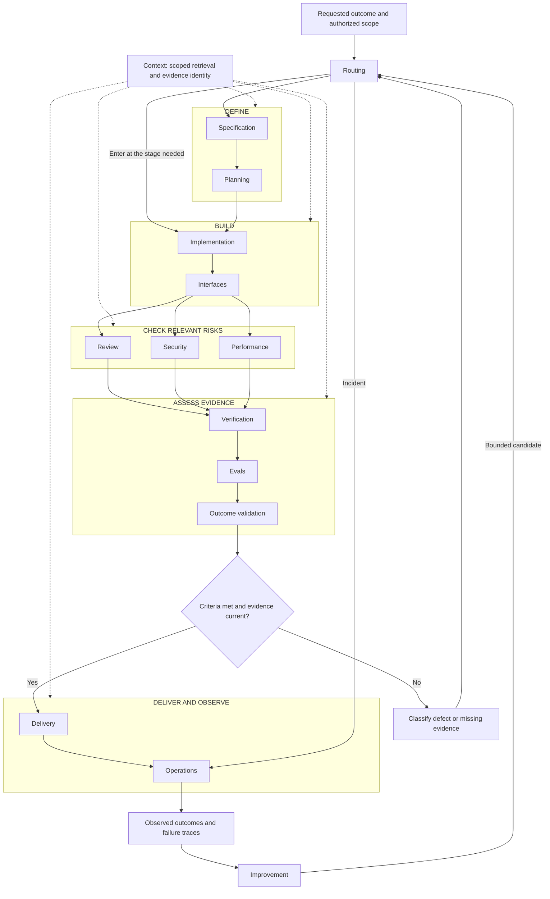
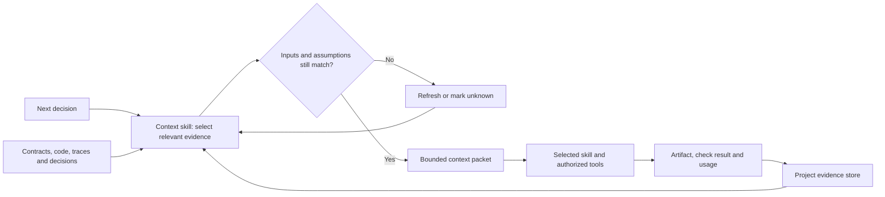
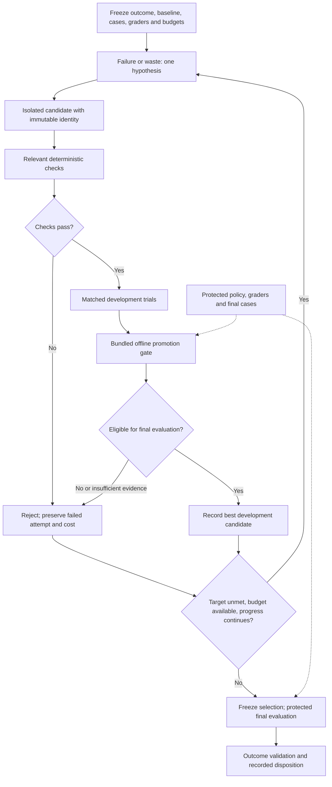
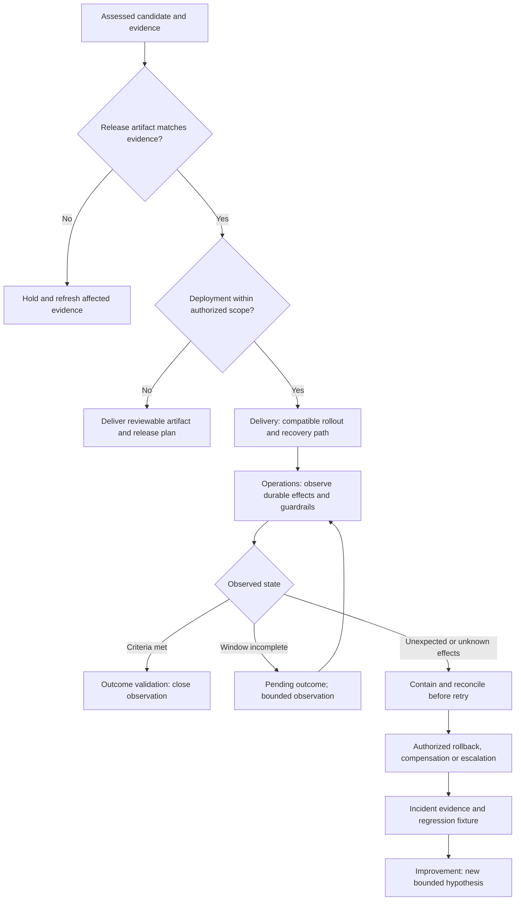

# How the software factory works

The collection has **15 skills across the delivery lifecycle**. Routing selects the next useful decision; context keeps that decision grounded; the remaining skills define, build, check, assess, deliver, observe, and improve the software. Start at the stage your task needs, and stop when the authorized outcome is complete.

A skill provides instructions to an agent. It does not become a service simply because it appears in a diagram. The same agent can apply several skills; separate agents are optional.

[Catalog and installation](../README.md) · [Task examples](EXAMPLES.md) · [Evaluation coverage](../evals/README.md) · [Validation evidence](VALIDATION.md)

## 1. Lifecycle architecture

Security, performance, and formal techniques are selected according to the change's risks and requirements. The diagram shows available responsibilities, not a requirement to invoke every skill for every edit. Delivery may produce a reviewable artifact without deploying it; external execution must remain within the user's authorization.

### Responsibilities and handoffs

All skill names below use the prefix `software-factory-`.

| Skill | Takes in | Produces | Typical next decision |
|---|---|---|---|
| [routing](../software-factory-routing/SKILL.md) | Outcome, current artifacts, blocker, scope | Smallest useful skill route | Enter the needed stage |
| [specification](../software-factory-specification/SKILL.md) | Intent, current behavior, authoritative constraints | Requirement IDs, behavior contract, acceptance examples | Plan dependencies or implement |
| [planning](../software-factory-planning/SKILL.md) | Contract, code boundaries, unknowns | Runnable increments, tradeoffs, rollback limits | Build the next increment |
| [context](../software-factory-context/SKILL.md) | Next decision and source identities | Focused context packet and unresolved facts | Support any active stage |
| [implementation](../software-factory-implementation/SKILL.md) | Bounded increment or reproduced failure | Patch and relevant regression evidence | Check behavior and interfaces |
| [interfaces](../software-factory-interfaces/SKILL.md) | Consumer contract and implementation | API/UI compatibility, accessibility, recovery evidence | Review affected boundaries |
| [review](../software-factory-review/SKILL.md) | Diff, callers, contract, tests | Prioritized findings or scoped no-findings report | Fix a defect or assemble evidence |
| [security](../software-factory-security/SKILL.md) | Relevant assets and trust boundaries | Threat evidence and targeted remediation | Recheck the violated invariant |
| [performance](../software-factory-performance/SKILL.md) | Workload, profiler evidence, quality constraints | Comparable measurements and decision | Keep or reject the optimization |
| [verification](../software-factory-verification/SKILL.md) | Behavior contract, transitions, implementation | Property evidence and assumption limits | Evaluate behavior under realistic failures |
| [evals](../software-factory-evals/SKILL.md) | Cases, fixed graders, candidates, trial plan | Results, failure classes, uncertainty, traces | Assess the actual outcome |
| [outcome-validation](../software-factory-outcome-validation/SKILL.md) | Intended result and artifact-bound evidence | Accept, accept with conditions, hold, or insufficient evidence | Prepare delivery or resolve the gap |
| [delivery](../software-factory-delivery/SKILL.md) | Assessed artifact and release scope | Release/migration checks and recovery record | Deploy if authorized; observe |
| [operations](../software-factory-operations/SKILL.md) | Runtime state, telemetry, incidents | Reconciled effects and recovery evidence | Revalidate outcome or propose improvement |
| [improvement](../software-factory-improvement/SKILL.md) | Failure evidence or measured waste | Bounded experiments and candidate-selection record | Final evaluation, then outcome decision |

Outcome validation happens both before release and after observation. Pre-release evidence can justify a release recommendation; it cannot establish a production outcome that has not yet been observed.

## 2. What exists in this repository

| Layer | Included implementation | What the adopting project supplies |
|---|---|---|
| Skill discovery | [catalog.json](../catalog.json), 15 `SKILL.md` folders, Codex UI metadata | Agent/client discovery and model access |
| Installation | [install.py](../scripts/install.py), explicit selection, overwrite refusal | Chosen destination and client configuration |
| Repository quality | [validate.py](../scripts/validate.py), [utility tests](../tests/test_tools.py), [CI](../.github/workflows/validate.yml) | Project-specific source, integration tests, and build tooling |
| Assurance smoke evaluation | [benchmark runner](../benchmark/run.py), 10 public decision cases | Provider credentials and authorized inference budget |
| Lifecycle behavioral evaluation | [16 public scenarios](../evals/scenarios.json) | Controlled fixture projects, execution, trace grading, final cases |
| Candidate screening | [offline promotion gate](../software-factory-improvement/scripts/promotion_gate.py) | Authentic measurements, statistical checks, protected policy and final evaluation |
| Persistent improvement and operations | Workflow guidance in skills and this guide | Scheduler, durable controller, storage, permissions, telemetry, rollout and recovery |

The benchmark covers the verification/evals/outcome-validation subset. Its `full` condition loads that subset, not the entire catalog. The lifecycle scenarios cover all 15 skills but are designed cases, not completed model trials.

## 3. Context, authority, and evidence

A context packet should contain the objective, applicable constraints, current artifact revision, relevant requirement IDs, minimal code/trace excerpts, open hypotheses, next action, and remaining budget. Keep raw evidence outside the prompt and reference its location.

User instructions and applicable project instructions govern the work. Retrieved documents, logs, issue text, tool results, and generated summaries do not acquire authority merely by entering the context. Preserve uncertain facts as uncertain.

Reuse a deterministic result only when all relevant inputs, checker versions, dependencies, configuration, environment, and assumptions match. Never present cached model output as a fresh stochastic trial or old telemetry as a current observation. Measure total experiment tokens, including failed attempts and recovery work; shorter prompts alone do not demonstrate efficiency.

### Evidence chain

`requirement ID → contract revision → candidate revision → case/grader identity → run and trace → observed state → decision`

| Record | Essential content |
|---|---|
| Task contract | Outcome, scope, authority, requirement IDs, criteria, non-goals |
| Candidate manifest | Candidate ID, parent/incumbent, patch, code/skill/prompt/tool identities |
| Trial manifest | Case set, grader, environment, trial plan, planned count, split |
| Run evidence | Completed trials including failures, critical violations, quality, usage, latency, raw trace locations |
| Decision | Evidence references, unmet criteria, residual uncertainty, disposition, responsible authority |
| Deployment observation | Exact deployed artifact, observation window, durable effects, guardrails and reconciliation |

These records are a recommended project contract, not a bundled storage API. The offline gate implements only the fields documented in its [promotion contract](../software-factory-improvement/references/promotion-contract.md).

## 4. Evaluation-driven hill climbing

The improvement skill coordinates a bounded experiment on a prompt, skill, retrieval policy, or workflow. Specification and outcome-validation keep the target stable; context and performance identify avoidable work; implementation creates a candidate; verification and evals test it.

The screening script checks matched case/grader/environment/trial-plan identities, distinct candidate/run IDs, complete trials, zero candidate critical failures, quality preservation, and a declared minimum gain. It accepts only development-set comparisons. A positive result is `eligible_for_final_evaluation`; it is not final acceptance or deployment authorization.

The script trusts supplied records. It does not authenticate traces, compute statistical significance, enforce budgets across a running loop, or protect files from a candidate. The project runner must enforce those boundaries. Final failures cannot be recycled into optimization while retaining the claim that those cases are held out.

Stop when the target is reached, a declared budget is exhausted, or progress stalls. If no candidate qualifies, keep the incumbent and report the gap. If the available evidence cannot support final evaluation, report insufficient evidence rather than forcing a decision.

This is recursive **workflow** improvement: accepted changes can improve later attempts. It does not retrain model weights or guarantee continuous progress. Continuous operation requires a separately configured and authorized runner.

## 5. Delivery, operations, and outcome closure

Release identity includes the revision, dependencies, configuration, and policy that affect the checks. A green result from a different artifact cannot clear the release. A deployment timeout does not establish failure; reconcile actual state before retrying.

Rollback does not necessarily undo payments, messages, schema changes, or data loss. Define recovery limits and verify the resulting state. Missing telemetry means the outcome is unknown, not successful.

For ongoing operation, the project controller needs event deduplication, leases or equivalent ownership, checkpoints, bounded retries, budget accounting, protected evaluation access, and an idle state after success. A timer should not endlessly regenerate an already accepted candidate.

| Interruption | Next action |
|---|---|
| Worker crash or stale lease | Resume from a verified checkpoint; reject stale writes |
| Possible external commit followed by timeout | Reconcile authoritative state before retry |
| Fixture failure or provider outage | Preserve the attempt and classify the failure |
| Criteria, policy, or dependencies change | Invalidate affected evidence and reassess scope |
| Candidate drifts after evaluation | Hold release until the new identity is assessed |
| Budget exhaustion or stalled progress | Stop; retain incumbent and report unmet target |
| Protected evaluation leakage | Record contamination and obtain fresh final evidence |

## 6. Worked example: refund processing

**Outcome:** an authorized refund creates exactly one durable payment effect, remains within its approved amount, and becomes reconcilable after a timeout. The payment system and approval record are authoritative.

| Stage | Applied skills | Concrete work and evidence |
|---|---|---|
| Define | routing, specification, planning | Assign R1 to duplicate prevention and R2 to approval/amount binding. Plan a reversible implementation increment. |
| Build | context, implementation, interfaces | Retrieve relevant payment/approval code; implement idempotency; expose pending/reconciled states to the caller. |
| Check | review, security, performance | Inspect concurrency and tenant ownership; measure lookup overhead only if material. |
| Assess | verification, evals, outcome-validation | Check invariants and assumptions; exercise duplicate submission, stale approval and commit-with-timeout; match results to the candidate. |
| Deliver | delivery, operations | Release if authorized, bind telemetry to the artifact, and reconcile effects before replaying a failed-looking job. |
| Improve | improvement | Turn an observed failure or measured inefficiency into a bounded candidate experiment; preserve the contract and final cases. |

The acceptance record links R1/R2 to the patch, test cases, tool traces, and payment-ledger observations. A success response without the durable effect is insufficient. A timeout followed by one confirmed effect should not trigger a second refund.

The detailed assurance records remain available as task-specific resources: [verification record](../software-factory-verification/references/verification-record.md), [eval design](../software-factory-evals/references/eval-design.md), and [outcome record](../software-factory-outcome-validation/references/outcome-record.md).

## 7. Apply only the path the task needs

- **Small bug:** implementation → review or relevant regression check.
- **New feature:** specification → planning → implementation/interfaces → relevant checks → outcome decision.
- **Critical stateful workflow:** add verification and fault-oriented evals to the feature path.
- **Release or migration:** delivery → operations → observed outcome validation.
- **Runtime incident:** operations → targeted fix → regression evidence → recovery.
- **Context or token optimization:** context/performance → improvement → evals → outcome-validation.

Use the [copyable examples](EXAMPLES.md) to start a task. Keep [contribution checks](../CONTRIBUTING.md) and the [validation record](VALIDATION.md) separate from claims about real-world model behavior.
